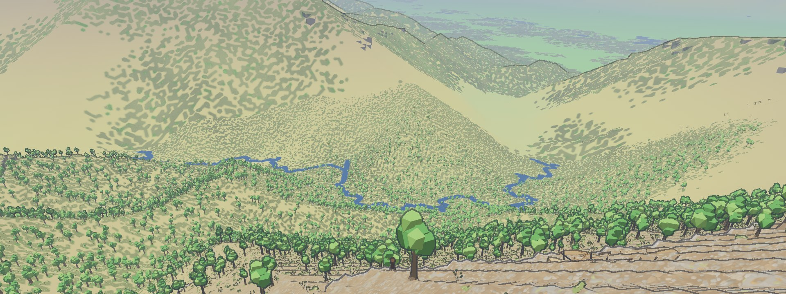
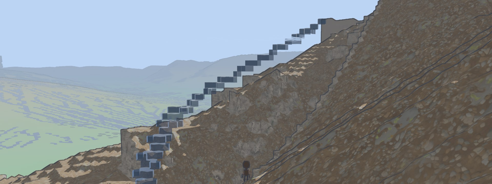
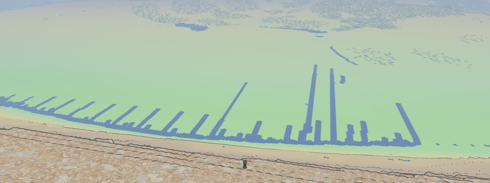
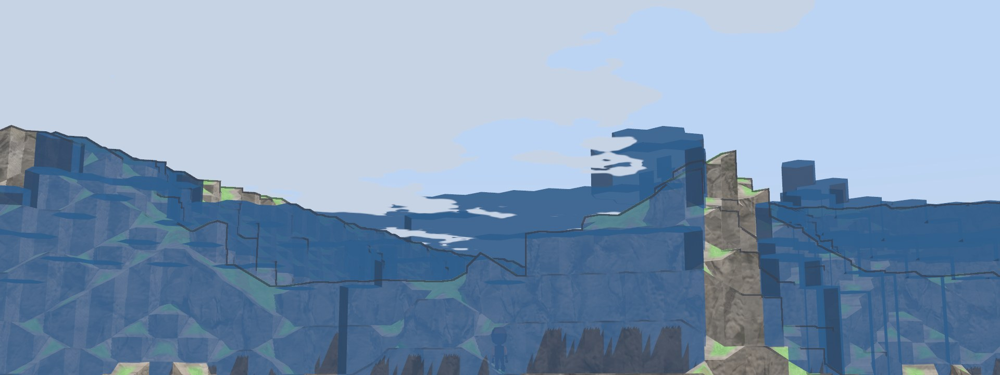
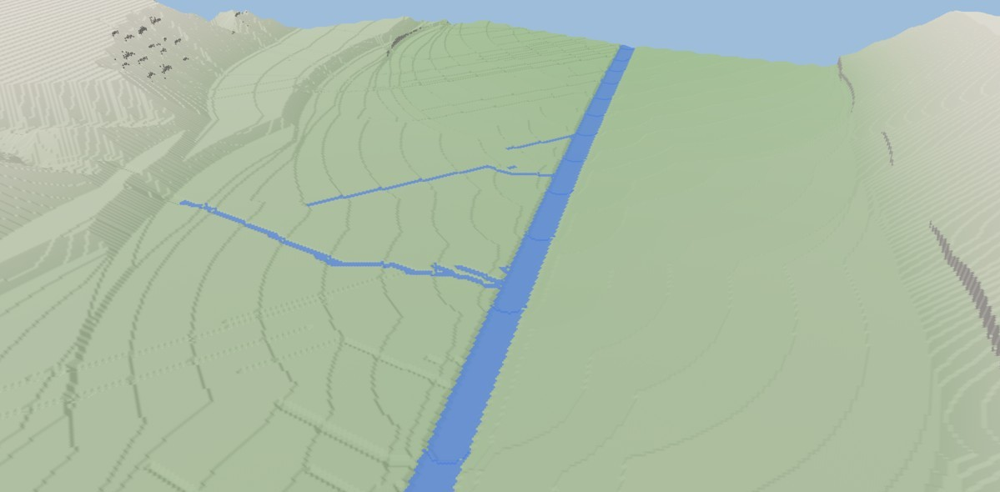
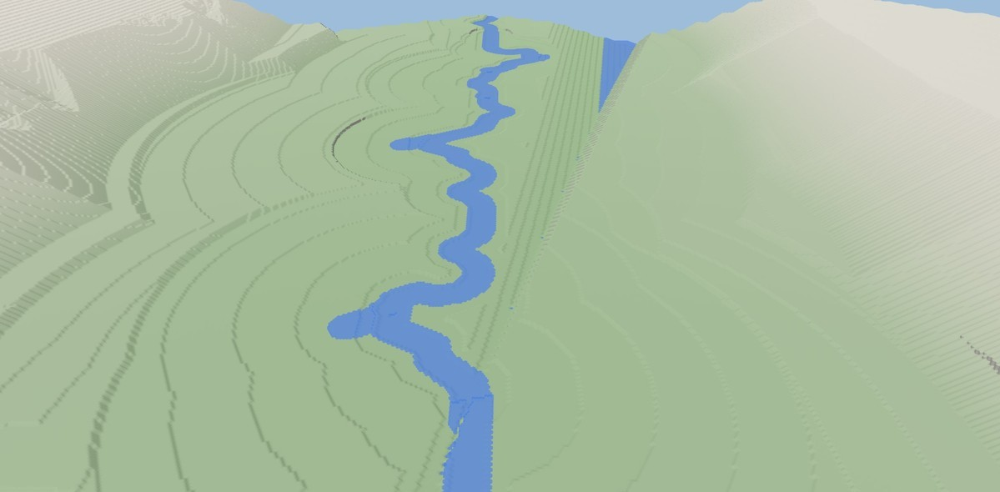
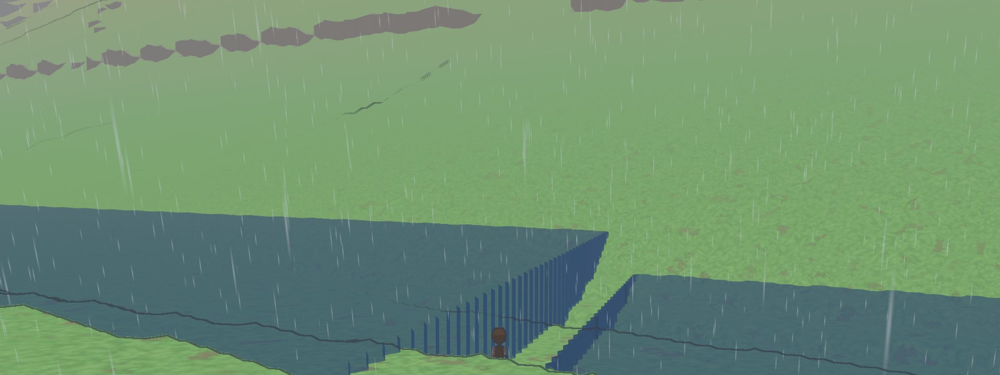
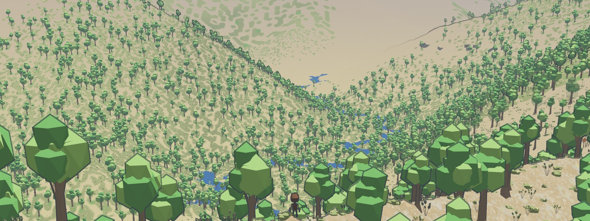

Our last post ended with "the rivers went in this month." That evening we
deleted them: four layers of the world generator, 4,295 lines of code. The
river above replaced them. It runs about five kilometres from where a new
player starts.

The old rivers were routed between points 525 tiles apart. The generator
knew the ground's height at those points and assumed a straight line between
them, so wherever a ridge stood between two points, the river ran over it.
In one stretch of the world we counted 20 places where a river climbed 16
metres or more. Every patch we made moved the climbs somewhere else.

The new generator builds the ground on hex cells of seven sizes, each three
times finer than the one above, from cells 729 tiles across down to single
tiles. Water is routed at every size. A river found among the big cells is
handed down to the next size, which lays it over its own finer ground and
finds smaller rivers there.

In its first days in the game the new water stood in the air, a staircase of
blocks up the side of a mountain.

Then the rivers ran straight. Each size hands its ground down to the next as
flat sloping triangles, and every stream on a flat slope takes the same
steepest way down. A slope full of streams came out as a comb.

That is October 15, mid-afternoon.

What straightened out the comb was handing a river down whole. A level now
passes each river's course to the next size, which bends it through the
ground beside it, so a river picks up bends at every size. A stream that
starts on a plain wanders toward whatever lies lower around it, so streams
gather into trunks.

Those two are the same valley in our world viewer, which draws the
generator's tiles without the game's look: on October 22, then today.

Lakes still go wrong. That one, yesterday morning, ends in a straight wall
of water.

When they work, a stream runs down a wooded valley and fills a few ponds on
the way.

The rivers come from a generator: seeded code, no trained model, nothing
drawn by hand. Claude writes that code with us, and we decide what a river
should look like and throw out what isn't one.
