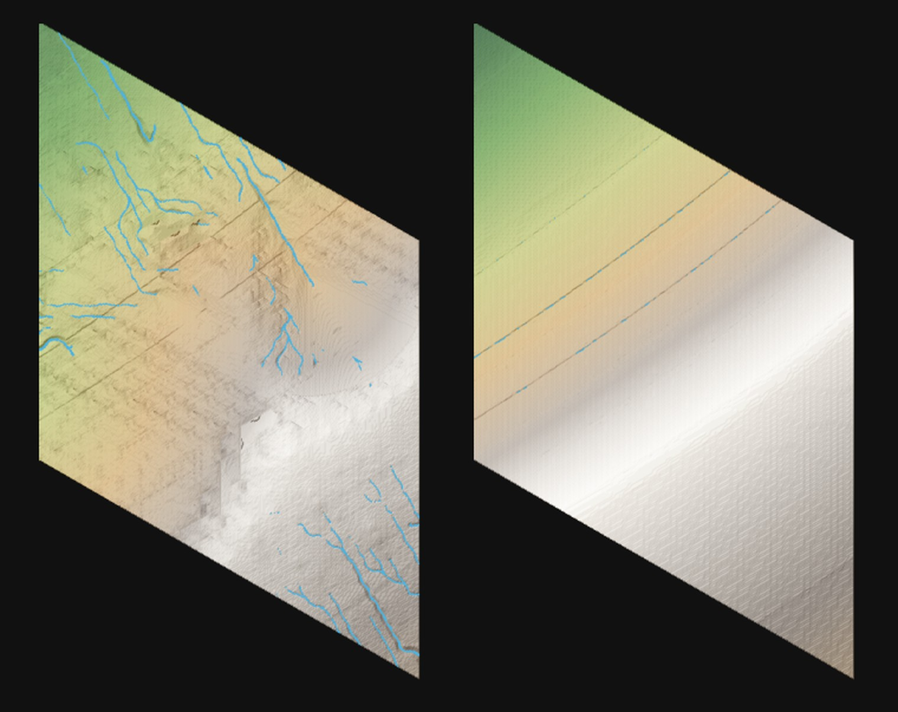
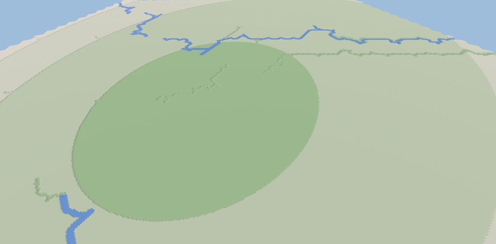

<video src="valley.mp4" poster="valley.jpg" autoplay muted loop playsinline aria-label="Sliding out over a wooded slope above a river winding along the valley floor, the valley opening onto a plain and mountains beyond"></video>

Our last post ended with "the rivers went in this month." That evening we
deleted them.

They had a flaw nothing we added could reach. The old generator routed water
between points 525 tiles apart. It knew the ground's height at those points
and nowhere else, so it assumed the ground ran straight from one to the
next, and wherever a ridge stood between two points, the river went over it.
In one stretch of the world we counted 20 places where a river climbed 16
metres or more.

We had spent nearly four weeks on it by then, each fix laid over the last: points
moved onto the troughs between ridges, troughs published for the points to
find, a rule for where two streams meet. Every fix moved the climbs somewhere
else. By October 12 four layers of the generator existed only to make
rivers, and the rivers still climbed. We took out all four, 4,295 lines, and
started again from what a river has to do.

## Rules first

We wrote the rules down before any code. A big river never climbs. A small
stream may climb a little. A hollow fills to its lip and spills over, so
lakes are welcome. And nothing gets checked by sampling the ground along a
river's length, because the far view of the world can't pay for it.

Every generator we read that gets rivers right does it one of two ways.
Some build the terrain from the rivers, and the ranges grow around the
drainage. Others let a river own the ground under it, cutting it down to a
bed that only ever falls. Our ranges already come from colliding plates, so
our rivers had to own their ground.

## Coarse to fine

The next day the world moved onto hex cells of seven sizes, each three times
finer than the one above, from cells 729 tiles across down to single tiles.
Water is routed at every size. The coarsest cells find the big rivers and
cut their valleys. Each finer size takes the rivers handed down to it, lays
them over its own ground, and finds the smaller streams between them.

On the left is the land around the haven, where new players start, on
October 13: streams branching into rivers, each in a valley of its own. On
the morning of the 14th it went into the game.

The water stood in the air. A river coming down a mountain hung over the
slope as a staircase of blocks, and more than half the wet tiles round the
haven held water above their own ground. Some of that was the generator and
some was how the game draws a river stepping down from one tile to the next.

The drawing went first. A fall is now drawn only where the ground beyond the
water is lower, and the afternoon before that rule held, the world went
under walls of water.

## Combs

Then the rivers ran straight. Each size hands its ground down to the next as
flat sloping triangles, and water on a flat slope takes the one steepest way
down, the same way for every stream on it. A hex grid makes it worse: a
stream turns only where the ground beside it falls away faster than the
ground ahead, and on a smooth flank nowhere does. A mountainside's streams
came out as the teeth of a comb.

We tried roughening the ground, which changed nothing, and holding each
river to the line the coarse cells drew for it, which made rivers climb
again.

Then we lost the valleys. We had made where a river starts depend on how
steep the ground is, and how hard it cuts on the rain its land gathers. The
haven is dry, gently sloping country, and around it the share of ground any
river had cut fell from 98% to none. That is the
right-hand map above.

Rain was the wrong thing to read. Valleys are cut over thousands of years by
floods, and a dry country's floods run as high for their land as a wet
one's. A river now cuts by the land it drains, and rain decides only how
wide its water runs today. Around the haven, 84% of the ground came back
cut.

The comb was still there. A level handed its rivers down as heights at its
own points, so any bend smaller than one of its cells was lost on the way
down, and the finer river sat in the straight groove the coarser one left.
Now a level hands down each river's course whole, and the next size bends it
through the ground beside it, so a river picks up bends at every size. A
stream that starts on a plain wanders toward whatever lies lower, so streams
gather into trunks.

That is one valley in our world viewer, which draws the generator's tiles
without the game's look: on October 22, then today.

## Lakes

Lakes came last. A lake the coarse cells found in a wide basin used to
vanish at the tiles, because no small cell could see the whole basin, and
the lake dried to a flat disc.

So a lake is handed down like a river. The morning after that went in, this
was waiting.

Where a finer valley crossed the lake's rim, the lake stood on at its old
level, a wall of water over the river that should have drained it. By nine
that morning each size was flooding every lake handed to it afresh from its
own ground, and the water standing round the haven fell from 22,848 tiles to
5,773.

Now a stream coming down a wooded valley fills a few ponds on its way.

The rivers come from a generator: seeded code, no trained model, nothing
drawn by hand. Claude writes that code with us, and we decide what a river
should look like and throw out what isn't one.
